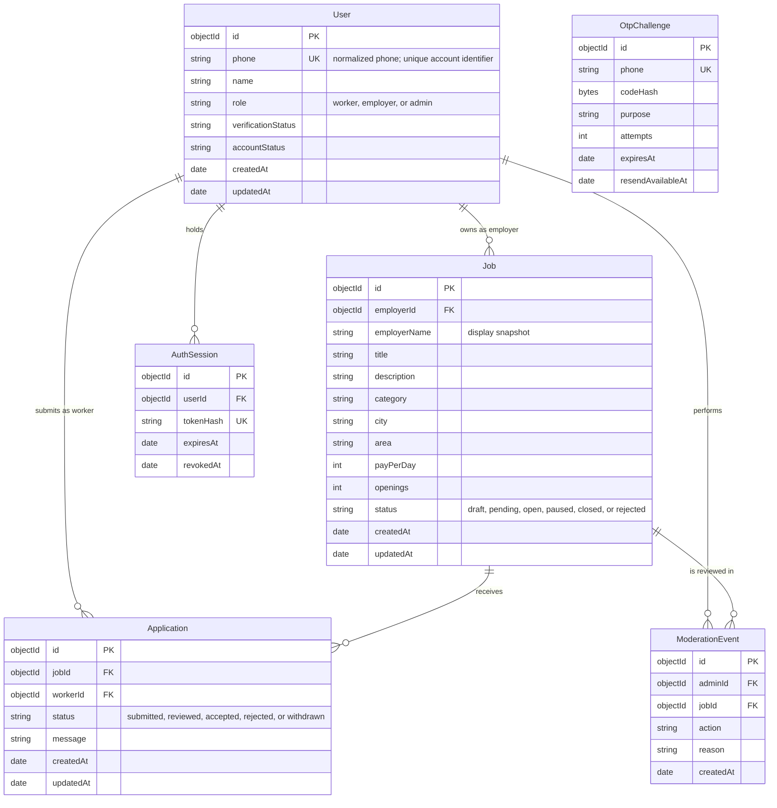

# Data Architecture & Persistence Layer

The persistence layer uses MongoDB through Mongoose and defines schemas for users, OTP challenges, sessions, jobs, applications, and moderation events. Authentication and job posting/search use persisted models; application and moderation workflows are not yet implemented.

## Database Configuration

| Service/Module | DB Type | Profile | Driver | Connection | Migration Tool |
|---|---|---|---|---|---|
| API | MongoDB | Local development example; no separate application profiles detected | Mongoose 8 MongoDB driver | `MONGODB_URI` is read at startup; example URI targets local `rozgaar-setu` database. No pool settings detected. | None detected. Mongoose schema/index definitions are the current schema mechanism; no versioned migrations or seed scripts found. |

## Data Ownership per Service

| Service | Tables Owned | ORM Framework | Caching | Notes |
|---|---|---|---|---|
| API | `users`, `otpchallenges`, and `authsessions` are used by authentication; `jobs` is used by search/posting; `applications` and `moderation_events` have schemas only | Mongoose | None detected | OTPs are hashed and expire; bearer session tokens are stored as hashes and sessions support revocation and expiry. |
| Web client | None | None | Browser `localStorage` for applied job IDs | Local application markers are client-only, not authoritative, and are not linked to a user or persisted in MongoDB. |

## Entity Model

### Current entity schemas

`Job` is defined in [server/src/models/Job.ts](../../../../../server/src/models/Job.ts). It stores a reference to `User`, an employer display-name snapshot, job details, a nested city/area location, pay, openings, and open/paused/closed status. Mongoose timestamps add `createdAt` and `updatedAt`; indexes support employer lookup and status/category/city/recent-job filtering. Job creation now requires an authenticated employer and uses the authenticated user ID and name.

`User` is defined in [server/src/models/User.ts](../../../../../server/src/models/User.ts), with unique phone, name, role, verification and account statuses, and an optional embedded worker profile. [OtpChallenge](../../../../../server/src/models/OtpChallenge.ts) stores a salted OTP hash, registration/login purpose, role/name details, attempt count, resend time, and TTL expiry. [AuthSession](../../../../../server/src/models/AuthSession.ts) stores a hash of an opaque bearer token, user reference, expiration, and revocation time. Registration, login, and authentication endpoints use these schemas; OTP issuance is available only in explicit local development mode until SMS delivery is integrated.

`Application` in [server/src/models/Application.ts](../../../../../server/src/models/Application.ts) references a job and worker, stores application status and an optional message, and declares uniqueness for each job/worker pair. `ModerationEvent` in [server/src/models/ModerationEvent.ts](../../../../../server/src/models/ModerationEvent.ts) references an admin and job and stores action, reason, and creation time. These two models are not yet used by API routes.

No Mongoose repository abstraction or transaction configuration was detected. The job route calls model operations directly. The web client stores application IDs in browser `localStorage`; there is no server-side application workflow.

### Target model and implementation gaps

The following model summarizes the current schemas and recommended relationships. Mongoose will create/use the corresponding MongoDB collections when model operations run. A worker and employer are both users differentiated by role; admin is a role on the user record. Contact-verification token storage is not implemented and should be introduced only with a defined verification flow.

<!-- mermaid-checked: every attribute is `<type> <name> [<key>] ["<description>"]` with at most one of PK/FK/UK, no \n in descriptions, no {} in descriptions, every relationship label is double-quoted -->

#### Recommended field and index details

| Collection | Recommended fields and constraints |
|---|---|
| `users` | Implemented fields: unique `phone`, `name`, `role` enum (`worker`, `employer`, `admin`), `verificationStatus`, `accountStatus`, and optional worker profile fields `skills`, `experienceYears`, and `preferredLocations`; timestamps. Normalize Indian phone numbers before persistence. |
| `otpchallenges` | Implemented phone-unique challenge with scrypt-hashed six-digit code plus random salt, registration/login purpose, registration name/role, failed attempt counter, resend cooldown, and TTL expiry. Codes are returned only when `OTP_DEV_MODE=true` outside production; no production SMS provider is configured. |
| `authsessions` | Implemented user reference, SHA-256 token hash, expiry TTL index, and revocation timestamp. Raw bearer tokens are returned at verification and are not persisted. |
| `jobs` | Implemented title, description, category, location, daily pay, openings, employer reference, employer display snapshot, status (`open`, `paused`, `closed`), and timestamps. The proposed pending/rejected moderation states and `expiresAt`/`approvedAt` require model changes before their use. |
| `applications` | Implemented `jobId`, `workerId`, status, optional worker message, and timestamps. Declares a unique compound index on `{ jobId: 1, workerId: 1 }` plus indexes for `{ workerId: 1, createdAt: -1 }` and `{ jobId: 1, status: 1 }`. |
| `moderation_events` | Implemented `adminId`, `jobId`, action, optional reason, and creation timestamp; indexes `{ jobId: 1, createdAt: -1 }` and `{ adminId: 1, createdAt: -1 }`. Treat these events as append-only in the service layer. |

Use MongoDB ObjectIds as document identifiers and explicit references rather than embedding potentially unbounded application histories inside a job or user. Keep bounded profile values embedded in `users`; keep job location embedded as the existing `{ city, area }` value. Add schema-level enum and bounds consistently in both Zod request schemas and Mongoose models.

## Key Repository Methods

| Service | Repository | Notable Methods | Purpose |
|---|---|---|---|
| API | `JobModel` in [server/src/models/Job.ts](../../../../../server/src/models/Job.ts) | `find(filter).sort(...).skip(...).limit(...).lean()` in [server/src/routes/jobs.ts](../../../../../server/src/routes/jobs.ts) | Retrieves a page of open jobs using optional category, city, and text filters. |
| API | `JobModel` in [server/src/models/Job.ts](../../../../../server/src/models/Job.ts) | `countDocuments(filter)` in [server/src/routes/jobs.ts](../../../../../server/src/routes/jobs.ts) | Computes matching-job count for pagination. |
| API | `JobModel` in [server/src/models/Job.ts](../../../../../server/src/models/Job.ts) | `create(job)` in [server/src/routes/jobs.ts](../../../../../server/src/routes/jobs.ts) | Persists a new job record with the employer ID and display name from the authenticated employer session. |
| API | `UserModel`, `ApplicationModel`, `ModerationEventModel` in [server/src/models/](../../../../../server/src/models/) | `UserModel.findOne`, `create`, and `save` in [server/src/routes/auth.ts](../../../../../server/src/routes/auth.ts); no application/moderation methods | Looks up, registers, and updates verified users. Application and moderation schemas remain unused by routes. |
| API | `OtpChallengeModel`, `AuthSessionModel` in [server/src/models/](../../../../../server/src/models/) | `findOneAndUpdate`, `create`, `deleteOne`, and `updateOne` in [server/src/routes/auth.ts](../../../../../server/src/routes/auth.ts) | Enforces per-phone resend cooldown, bounded OTP attempts, single-use challenge consumption, and expiring/revocable login sessions. |

No separate repository classes/interfaces or custom bulk query methods were detected. For the target model, introduce query helpers only when needed by actual workflows: fetch a worker's applications by worker and date, fetch applications for employer-owned jobs with bounded pagination, and load applications for a set of job IDs in one query rather than issuing one query per job.

## Caching Strategy

No server-side cache provider, cache annotations, TTL policy, or cache-aside/read-through strategy was detected. Job search currently queries MongoDB directly. The client uses `localStorage` only for application markers, not as a shared or authoritative cache. Keep application records server-authoritative; if caching is later added, define invalidation for job status and moderation changes before caching publicly visible job results.

## Data Ownership Boundaries

The current system has one MongoDB database used by the API. Authentication uses User, OtpChallenge, and AuthSession; public search and authenticated employer posting use Job. Application and ModerationEvent schemas are not yet wired into API workflows. The browser's application markers are isolated per browser profile and are not shared with the API. No cross-service database access, separate services, CQRS/read models, or transaction use were detected.

In the proposed model, the API owns users, jobs, applications, and moderation events in the same database. References connect jobs to employer users, applications to jobs and worker users, and moderation events to the admin and affected job. Enforce authorization in the API before writes; clients must not provide trusted employer, worker, or admin IDs. Prefer paginated reads and indexed references. If an operation later needs atomic writes across documents, assess MongoDB replica-set transaction support; do not assume transactions are configured in the current local setup.

### Data Classification & Sensitivity

| Entity | Sensitive Fields | Classification (PII/PHI/PCI/None) | Controls in Place |
|---|---|---|---|
| `Job` (current) | `employerName`, city, area, free-text description | PII may be present, depending on user-entered content | No field-level encryption, masking, or access controls identified in the schema. The public search route exposes open jobs; avoid placing phone numbers or other private contact details in public job descriptions. |
| `User` | phone, name, worker skills and preferred locations | PII | OTP verification and authenticated role checks protect account/job writes. No field-level encryption or masking detected; minimize fields and redact logs. |
| `OtpChallenge` | phone, registration name | PII | OTP is stored as a salted scrypt hash with expiry and attempt limits; development code response is disabled in production. No field-level encryption detected. |
| `AuthSession` | user identity reference and token hash | PII by linkage | Raw token is not stored; session has expiry and revocation support. No field-level encryption detected. |
| `Application` (schema only) | worker identity reference and optional message | PII by linkage and possible free text | Schema exists; no workflow routes or access controls detected. Restrict reads to the worker, owning employer, and authorized admins. |
| `ModerationEvent` (schema only) | admin identity reference and reason | PII by linkage; may contain sensitive free text | Schema exists; no moderation routes/access controls detected. Restrict access to admins and record only necessary reasons. |

No PHI or PCI data is required by the current model. Free-text fields should be treated as potentially sensitive user input even when their intended purpose is not to collect PII.

> Note: Application and ModerationEvent schemas are present but not yet used by API routes. Production SMS delivery remains unconfigured; only explicit non-production OTP mode can issue verification codes.
